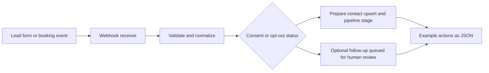

# Conceptual CRM automation architecture

## Intended GoHighLevel mapping

- Contact upsert → approved contact creation/update integration.
- Pipeline stage update → appropriate opportunity endpoint or GHL workflow action.
- Follow-up proposal → GHL workflow subject to verified consent and applicable laws.
- Appointment notification → GHL calendar and reminder workflow after appointment validation.

The payloads and action names in this repository are illustrative and **not** official GHL API objects. Live integrations require reviewing current vendor docs, authenticating securely, mapping actual location/contact/opportunity IDs, retries, logging, validation, and opt-out handling.
